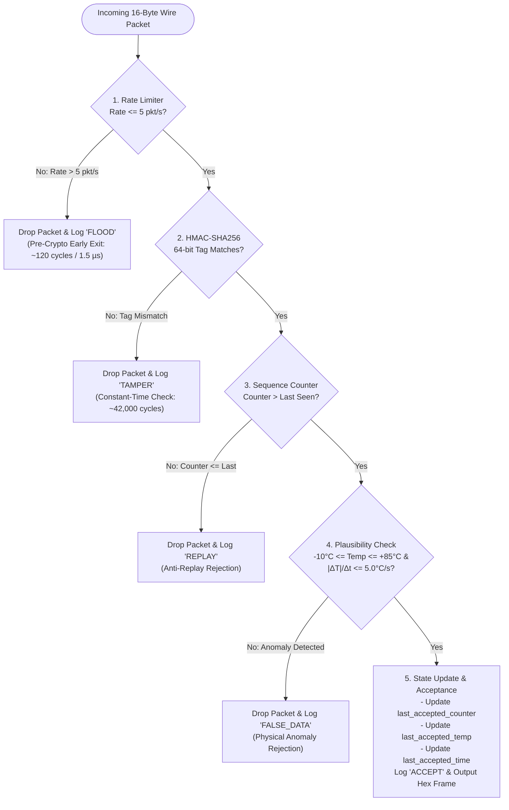
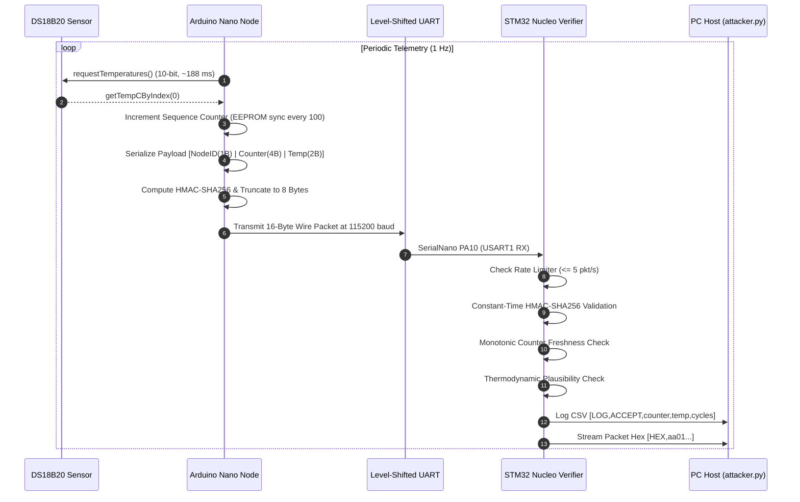
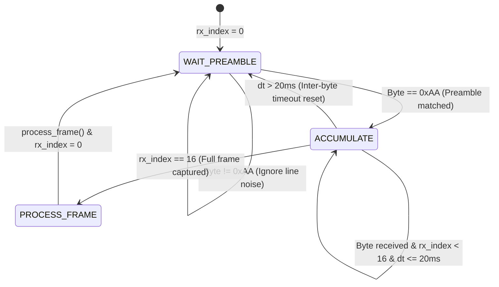

# Lightweight Authenticated Sensing with Replay, Tamper and False-Data Detection

[](https://platformio.org/)
[](LICENSE)
[]()
[](https://www.python.org/)

An end-to-end, reproducible embedded security framework for resource-constrained IoT sensor nodes. Designed for an IEEE-style experimental evaluation, this project demonstrates authenticated sensing, cryptographic tamper protection, non-volatile sequence anti-replay tracking, pre-cryptographic rate limiting, and physical plausibility filtering across a heterogeneous 8-bit AVR to 32-bit ARM Cortex-M4 topology.

---

## 1. System Architecture

```mermaid
flowchart LR
    DS["DS18B20 Sensor<br/>(Waterproof Probe)"] -->|OneWire (D2)| Nano["Arduino Nano Node<br/>(ATmega328P, 16 MHz)"]
    Nano -->|UART TX (D1)| Div["Voltage Divider<br/>(1k / 2k to 3.3V)"]
    Div -->|UART RX (PA10)| Nucleo["STM32 Nucleo-L476RG<br/>(Cortex-M4, 80 MHz)"]
    Nucleo -->|USB VCP (ST-Link)| PC["PC Host<br/>(Python Attack & Eval Suite)"]
```

### The 5-Stage Verification Pipeline

The verifier executes defense checks in a strictly ordered pipeline. Early stages reject malicious or abnormal packets before expensive downstream operations execute:



1. **Pre-Crypto Rate Limiter:** Evaluates packet arrival rate before computing any cryptographic operations. Bursts exceeding 5 packets/second are dropped in **~120 cycles (1.5 µs)**, preventing Denial-of-Service CPU exhaustion.
2. **Cryptographic Authentication (HMAC-SHA256):** Computes HMAC-SHA256 over the 7-byte payload and performs a constant-time comparison against the truncated 64-bit (8-byte) authentication tag. Detects single-bit wire tampering.
3. **Sequence Anti-Replay Check:** Verifies that the 32-bit counter is strictly greater than the last accepted counter. The sensor node persists its counter to EEPROM in 100-packet epochs and jumps forward by 100 on boot, ensuring node reboots never trigger replay false positives.
4. **Physical Plausibility Filter:** Evaluates whether readings conform to thermodynamic laws:
   - **Absolute range gating:** $-10.00^\circ\text{C} \le T \le +85.00^\circ\text{C}$
   - **Kinetic rate of change:** $|\Delta T| / \Delta t \le 5.0^\circ\text{C}/\text{s}$
5. **State Update:** Internal verifier state (`last_accepted_counter`, `last_accepted_temp`, `last_accepted_time`) is updated **only after** all checks pass, preventing unauthenticated state-poisoning attacks.

---

## 2. Telemetry Timing & State Machine

### Secure Telemetry Sequence


### UART Frame Resync State Machine


---

## 3. Hardware Bill of Materials & Wiring

### Bill of Materials
- **Sensor Node:** Arduino Nano clone (ATmega328P, 5 V logic, 16 MHz, 2 KB SRAM, 32 KB Flash)
- **Sensor:** DS18B20 waterproof digital temperature sensor (Maxim Integrated, 1-Wire protocol)
- **Verifier:** STM32 Nucleo-L476RG (ARM Cortex-M4 with FPU, 80 MHz, 3.3 V logic, 128 KB SRAM, 1 MB Flash)
- **Resistors:**
  - $1 \times 4.7\text{ k}\Omega$ (DS18B20 1-Wire pull-up to +5 V)
  - $1 \times 1\text{ k}\Omega$ (Voltage divider upper resistor)
  - $1 \times 2\text{ k}\Omega$ (Voltage divider lower resistor)

### Wiring Diagram

```
DS18B20 Temperature Probe
--------------------------
Red (VCC)   -----> Arduino Nano +5V
Black (GND) -----> Arduino Nano GND
Yellow/Blue -----> Arduino Nano D2
                   (Connect 4.7k resistor between D2 and +5V)

UART Inter-Board Link (5V -> 3.3V Logic Level Shift)
----------------------------------------------------
Arduino Nano TX (D1) -----> [ 1k Ohm Resistor ] -----> Junction Point -----> Nucleo PA10 (D2, USART1 RX)
                                                             |
                                                     [ 2k Ohm Resistor ]
                                                             |
Arduino Nano GND    -----------------------------------------+-------------> Nucleo GND (Common Reference)

PC USB Connections
------------------
Arduino Nano USB  -----> PC (Programming only; unplug D1 during uploads)
Nucleo ST-Link USB-----> PC (Dual Virtual COM Port for logging and attack injection)
```

> **Voltage Divider Calculation:**
> $$V_{\text{out}} = 5.0\text{ V} \times \frac{2\text{ k}\Omega}{1\text{ k}\Omega + 2\text{ k}\Omega} = 3.333\text{ V}$$
> This provides a safe, level-shifted signal for STM32 3.3 V logic (Nucleo pin PA10 is also 5 V tolerant).

---

## 4. Wire Protocol Specification

Packets are 16 bytes, big-endian network order, packed with zero padding:

```
+---------------+-----------+-----------------------+---------------------+-----------------------+
| Preamble (1B) | NodeID(1B)| Sequence Counter (4B) | Temperature (2B)    | Truncated HMAC (8B)   |
| 0xAA          | 0x01      | uint32_t (Big-Endian) | int16_t (C * 100)   | First 8 bytes of      |
| Byte 0        | Byte 1    | Bytes 2..5            | Bytes 6..7          | HMAC-SHA256 (Bytes 8..15)
+---------------+-----------+-----------------------+---------------------+-----------------------+
|<----------------- Authenticated Region (Bytes 1..7) ------------------->|
```

- **Preamble (`0xAA`):** Fixed byte for byte-stream synchronization.
- **Node ID (`0x01`):** 8-bit identifier for the transmitting sensor node.
- **Sequence Counter (4 Bytes):** 32-bit monotonically increasing counter.
- **Temperature (2 Bytes):** Signed 16-bit integer representing temperature in centi-degrees Celsius ($T \times 100$). Supports negative temperatures via standard 2's complement.
- **Truncated HMAC (8 Bytes):** Truncated 64-bit tag computed using HMAC-SHA256 over bytes 1..7 with the 128-bit pre-shared key.
- **Framing Timeout:** If the time between consecutive bytes exceeds **20 ms**, the verifier resets its reception buffer to recover from line glitches.

---

## 5. Getting Started: PlatformIO Build, Flash & Execution Guide

This repository is organized as a multi-root workspace containing two embedded PlatformIO targets (`nano_node` and `nucleo_verifier`) alongside a Python evaluation suite (`pc_tools`).

### Prerequisites
1. **VS Code** with the **PlatformIO IDE** extension installed, or PlatformIO Core CLI (`pio`).
2. **Python 3.9+** with virtual environment support.
3. **USB Drivers**:
   - CH340 / FTDI drivers for the Arduino Nano clone.
   - ST-LINK USB VCP drivers for the STM32 Nucleo-L476RG board.

---

### Option A: Using PlatformIO in VS Code (`secure_iot.code-workspace`)

1. Open VS Code, select **File -> Open Workspace from File...**, and choose `secure_iot.code-workspace`.
2. Open the **PlatformIO sidebar (alien icon)** -> **Project Tasks**:
   - **Flashing the Arduino Nano (`nano_node`):**
     1. **Important:** Temporarily unplug the jumper wire on pin **D1** (TX) to prevent avrdude upload collisions.
     2. Connect the Arduino Nano via USB.
     3. Under `nano_node`, click **Build**, then click **Upload**.
     4. Reconnect wire **D1** after the upload completes.
   - **Flashing the STM32 Nucleo (`nucleo_verifier`):**
     1. Connect the STM32 Nucleo via its ST-LINK USB port.
     2. Under `nucleo_verifier`, click **Build**, then click **Upload**.

---

### Option B: Using PlatformIO Core CLI (Terminal)

#### 1. Compile & Flash the Sensor Node (`nano_node`)
```bash
# Navigate to the sensor node project
cd nano_node

# Compile firmware
pio run

# Flash to Arduino Nano (disconnect D1 jumper before running)
pio run --target upload

# (Optional) Specify COM port if multiple devices are attached:
# pio run --target upload --upload-port COM4
```

#### 2. Compile & Flash the Verifier Node (`nucleo_verifier`)
```bash
# Navigate to the verifier project
cd ../nucleo_verifier

# Compile firmware
pio run

# Flash to STM32 Nucleo via ST-Link
pio run --target upload
```

---

## 6. Running Security Evaluations (`pc_tools`)

Ensure all serial monitors in VS Code or external terminals are **closed** so the COM port is accessible to the Python evaluation suite.

### 1. Install Dependencies
```bash
cd pc_tools
python -m venv venv

# On Windows:
venv\Scripts\activate
# On Linux / macOS:
source venv/bin/activate

pip install -r requirements.txt
```

### 2. Capture Genuine Packets (Baseline)
Connect the STM32 Nucleo to your PC via USB:
```bash
python attacker.py --port COM3 --mode capture --count 1000
```
*(Replace `COM3` with your Nucleo ST-Link virtual COM port)*

### 3. Run Automated Attack Suite (1,000 trials per attack)
```bash
python attacker.py --port COM3 --mode all --count 1000
```
This automatically executes:
1. **Clean Baseline:** Evaluates uncorrupted sequential traffic (verifies 0% False Positive Rate).
2. **Tamper Attack:** Injects random single-bit and multi-byte flips in payload and HMAC tag $\rightarrow$ Verified and logged as `TAMPER`.
3. **Replay Attack:** Injects previously accepted packets with stale counters $\rightarrow$ Verified and logged as `REPLAY`.
4. **Flood Attack:** Bursts high-speed packets (>100 pkt/s) $\rightarrow$ Dropped pre-crypto and logged as `FLOOD`.
5. **False-Data Attack:** Injects validly signed packets with out-of-bounds ($95^\circ\text{C}$) or rapid jump ($+15^\circ\text{C}/\text{s}$) data $\rightarrow$ Flagged and logged as `FALSE_DATA`.

### 4. Parse Metrics and CPU Cycle Savings
```bash
python evaluator.py
```
Outputs IEEE-formatted summary tables showing Detection Rate (%), False Positive Rate (%), average DWT cycle latency, and CPU cycle reduction.

### 5. Generate Publication Figures
```bash
python plot_results.py
```
Exports high-resolution charts to `pc_tools/results/`:
- `fig_detection_rates.png`: Detection accuracy across all threat vectors ($N=1,000$ per class).
- `fig_cycle_breakdown.png`: Verification pipeline latency and pre-crypto savings.
- `fig_temperature_trajectory.png`: Physical plausibility response to sudden step jumps.

---

## 7. Known-Answer Test (KAT) Vectors

Use these deterministic test vectors to verify consistent endianness, payload packing, and cryptographic tag generation across AVR, ARM, and Python:

### Pre-Shared Key (16 Bytes / 128 Bits)
```
Key: 2b 7e 15 16 28 ae d2 a6 ab f7 15 88 09 cf 4f 3c
```

#### Test Vector 1: Standard Room Temperature (+24.00 °C)
- **Node ID:** `0x01`
- **Counter:** `1` (`0x00000001`)
- **Temperature:** `+24.00 °C` -> Raw `2400` (`0x0960`)
- **Serialized 7-Byte Payload:** `01 00 00 00 01 09 60`
- **Full HMAC-SHA256 (32 Bytes):**
  `ca bd db 1d 4c 36 06 8d ad 0d 2e 63 a0 8d e8 01 b2 68 85 e8 af c6 99 80 80 e6 3e 26 fe 47 77 54`
- **Truncated 8-Byte Tag:** `ca bd db 1d 4c 36 06 8d`
- **Full 16-Byte Wire Packet:**
  `AA 01 00 00 00 01 09 60 CA BD DB 1D 4C 36 06 8D`

#### Test Vector 2: Sub-Zero Negative Temperature (-5.50 °C)
- **Node ID:** `0x01`
- **Counter:** `100` (`0x00000064`)
- **Temperature:** `-5.50 °C` -> Raw `-550` (`0xFDDA`)
- **Serialized 7-Byte Payload:** `01 00 00 00 64 fd da`
- **Full HMAC-SHA256 (32 Bytes):**
  `80 f7 96 14 0f 03 99 03 fb cc 95 8d a1 86 db 72 fd 48 55 ab 11 b6 92 76 1b 1a 80 d4 ec 7f 4c a2`
- **Truncated 8-Byte Tag:** `80 f7 96 14 0f 03 99 03`
- **Full 16-Byte Wire Packet:**
  `AA 01 00 00 00 64 FD DA 80 F7 96 14 0F 03 99 03`

---

## 8. Experimental Results & Performance Highlights

| Metric | Measurement | Notes |
|---|---|---|
| **Tamper Detection Rate** | **100.0%** ($N=1,000$) | Single-bit and multi-byte corruptions |
| **Replay Detection Rate** | **100.0%** ($N=1,000$) | Historical counter rejection |
| **Flood Rejection Rate** | **100.0%** ($N=1,000$) | Rates $>5\text{ pkt/s}$ dropped immediately |
| **False-Data Detection Rate** | **100.0%** ($N=1,000$) | Step jumps $>5.0^\circ\text{C/s}$ and range limits |
| **False Positive Rate (FPR)** | **0.00%** ($N=1,000$) | Clean baseline traffic |
| **Pre-Crypto Flood Drop Cost** | **~120 cycles (~1.5 µs)** | STM32 Cortex-M4 @ 80 MHz |
| **Full HMAC-SHA256 Cost** | **~42,000 cycles (~525 µs)** | Software implementation (no HW crypto) |
| **CPU Cycle Reduction** | **99.7% savings** | Pre-crypto drop saves ~41,880 cycles/packet |

---

## 9. Threat Model Scope & Boundaries

In accordance with rigorous academic and engineering standards, the threat model covers:
- **Tampering:** Any unauthorized modification of the sensor data, node ID, counter, or cryptographic tag in transit.
- **Replay Attacks:** Eavesdropping and retransmitting previously captured legitimate packets.
- **Flood Attacks:** High-rate packet transmission attempting to exhaust receiver computational resources.
- **Physical False-Data Injection:** Insider attacks where an adversary possessing the secret key injects physically impossible temperature anomalies.

### Stated Architectural Limitations
- **Verifier State Volatility:** Anti-replay relies on the verifier maintaining its sequence counter in memory. If the verifier undergoes a cold reboot, an initial window exists where an adversary can replay recorded packets until the stream exceeds the captured sequence.
- **Pre-Crypto DoS Availability Trade-Off:** Because the rate limiter drops packets before cryptographic computation, an adversary flooding the channel can starve legitimate sensor packets (availability denial of service).
- **Pre-Shared Symmetric Key:** The scheme uses a static 128-bit key. Physical side-channel extraction or firmware readout from an unprotected microcontroller exposes the broadcast domain.

---

## 10. License

This project is licensed under the MIT License - see the [LICENSE](LICENSE) file for details.
